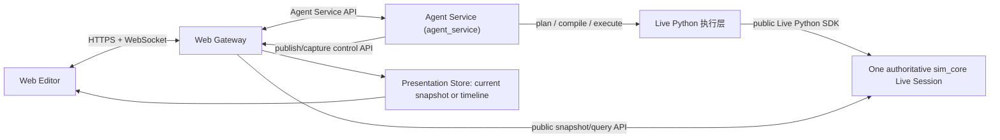

# Web Agent 服务与场景同步设计书

> 状态：Draft v0.1
>
> 日期：2026-08-05
> 涉及仓库：`F:\RobotSimPlatform`（Gateway 与 `agent_service`）

## 1. 背景与目标

RobotSimPlatform 已有 Web Editor、Web Gateway 和 `sim_core` Python SDK。早期的 Web Agent 通道只支持一次性 `text -> commands`，网页消息保存在浏览器 `localStorage`，不能形成服务端对话上下文；旧的外部 agent 服务已从本仓库移除，Gateway 侧只保留与实现无关的传输契约。

本次改造目标：

1. 在 `F:\RobotSimPlatform\agent_service` 中提供有持久对话上下文的 Agent Service，作为 Gateway 唯一的上游 agent 实现。
2. Agent Service 只通过 RobotSimPlatform 已发布的 Live Python 能力操作仿真，不引入第二套仿真运行时，也不直接导入或使用 MuJoCo。
3. Web Gateway 作为浏览器、Agent Service 和 `sim_core` 会话之间的边界，统一鉴权、会话绑定、消息过滤、场景发布和故障恢复。
4. 支持 `real-sync` 与 `sync-and-animate` 两种场景同步模式。
5. 用户默认只看到请求、阶段状态、最终答复和显式发布的场景，不看到 agent 的命令试错、工具参数、推理或临时状态。
6. 传输契约与具体 agent 实现解耦：任何满足 `/v1/conversations` 与 `GET /health` 的进程都能承载 Web turn。
7. Agent Service 不依赖 Gateway 才能运行，开发者可通过本地 CLI 发起和续接对话，直接验证模型、上下文和 Live 运行时接入。

非目标：

- 不把实时控制循环放进大模型进程。
- 不让浏览器直接连接 Agent Service 或 `sim_core`。
- 不以任何模型运行器的内部事件流作为跨服务公共协议。
- 不在 Gateway 侧实现任务规划、技能分解或轨迹计算。
- 不承诺无限长度、无限帧率的世界状态序列。

## 2. 现状结论与能力缺口

### 2.1 已有可复用能力

- Web Gateway：aiohttp、HTTP API、WebSocket 事件、Agent Job、场景 revision、`SceneService.snapshot()`。
- Web Editor：`SceneSnapshot` 渲染、Agent 面板、仿真控制、WebSocket 增量刷新。
- Live Python API：会话连接、场景查询/编辑、机器人控制、仿真启停和单步、状态保存/恢复。
- Gateway 侧传输层：`web/gateway/agent.py` 的 `AgentClient` 协议、`AgentServiceClient`、`/api/agent-control/*` 回调面和 Presentation Store。

### 2.2 Agent Service 如何使用模型

Agent Service 自己持有模型客户端，Gateway 不感知模型厂商、提示词或工具协议。分层原则：

1. Gateway 只发送结构化 turn 请求（`requestId`、`message`、`controlContext`、`debug`），不拼装自然语言指令。
2. Agent Service 用大模型完成自然语言理解与任务分解，产出结构化的 TaskIntent / SkillPlan。
3. 从 SkillPlan 到具体命令、IK、碰撞检查和轨迹的编译与执行必须是确定性的，不经过模型；模型永远不直接输出关节角、轨迹点或执行器指令。
4. 执行阶段只通过 Live Python 会话操作 Gateway 已绑定的权威世界。
5. Agent Service 通过 `controlContext` 中的回调地址和 token 把快照、timeline、capture 发布回 Gateway。

模型接入使用 OpenAI 兼容端点（Qwen）。base URL、模型名和 API key 全部来自环境变量，不写入仓库文件。

### 2.3 必须先补齐的平台统一快照能力

平台内部已有 C++ `WorldSnapshot`，C API/Python SDK 也已有 `sim_save_state`/`State`，但它们的语义是可恢复检查点：调用者获得 opaque handle 或 `.simstate` 文件，用于恢复世界，不是可读取、可传输的观察快照。Web 所需快照必须是另一个明确的公共概念，不能改变现有 `save_state` 的含义。

目标架构要求 RobotSimPlatform 在所有公共调用面提供同一份版本化观察快照：

- C API：从指定 world 导出稳定、可序列化的 `SceneSnapshot`。
- Python SDK：同进程 `Simulator.scene_snapshot(world)` 返回强类型 Python 模型。
- Live Session：跨进程 `LiveSession.scene_snapshot()` 返回相同模型。
- 提供 `scene.changed`/revision 可观察机制，或 Gateway 的有界轮询替代方案。
- 明确快照中的稳定对象身份、scene generation、revision、simulation time 和资源引用。

三种调用面必须由同一个 native snapshot builder 和同一个 schema/version 派生，禁止分别拼装近似结构。若 Agent 连接一个 Live Session，而 Gateway 仍持有另一个进程内 `SceneService`，两者会成为两个世界，无法满足同步语义。

在统一快照能力完成前，只能做单进程 Gateway 原型，不能宣称 Agent 与 Web 正在操作同一个外部 Live Session。Agent 运行时 skill 明确禁止通过私有 `_request()` 或手写 RPC 绕过这一缺口。

### 2.4 状态与快照术语

| 名称 | 语义 | 是否可恢复 | 是否供 Web/Agent 读取 |
| --- | --- | --- | --- |
| `WorldSnapshot`（现有 C++ 内部） | ECS/时间/随机状态的内部拷贝 | 是 | 否，内部类型不作为 ABI |
| `State` / `SimStateHandle`（现有） | 物理后端在内的 opaque 检查点 | 是 | 否 |
| `SceneSnapshot`（新增公共模型） | 某一时刻的只读观察投影 | 否 | 是 |
| `Timeline` | 多个 `SceneSnapshot` 的有序集合 | 否 | 是 |

`SceneSnapshot` 不承诺包含恢复仿真所需的所有 backend 私有状态；调用方不得把它传给 `restore_state`。

### 2.5 统一 SceneSnapshot 合同

公共 snapshot schema 至少包含：

- `schemaVersion`、`sceneId`、`worldId`、`sceneGeneration`、`revision`；
- `simulationTime`、`status`、固定步长等必要仿真元数据；
- 按稳定 `objectId` 排序的实体列表，同时保留进程内 handle 作为可选定位信息；
- parent、name、flags、local/world transform；
- visual、collider、rigid body、camera/sensor、robot joint state 等可选组件；
- 资源只保存规范化引用和内容标识，不内嵌 mesh/texture 大块二进制。

C API 首版使用 UTF-8 JSON 作为稳定 ABI，采用两阶段 buffer 读取，避免把可变长嵌套结构固化为大量 C struct：

```c
int sim_scene_snapshot_json_size(
    SimHandle* simulator, SimWorldHandle world, size_t* output_size);
int sim_scene_snapshot_json(
    SimHandle* simulator, SimWorldHandle world,
    char* output_utf8, size_t output_capacity, size_t* output_size);
```

`output_size` 包含末尾 NUL；容量不足返回明确错误码并写回所需长度。第二次调用必须返回一个自洽快照；若世界在两次调用间变化，调用方按新长度重试，不能得到半旧半新的数据。后续如性能数据证明 JSON 是瓶颈，可增加二进制编码 API，但不得替换或破坏 v1 JSON ABI。

Python SDK 暴露：

```python
snapshot: SceneSnapshot = simulator.scene_snapshot(world)
```

SDK 通过上述 C API 获取 JSON，再校验为 `SceneSnapshot` 强类型模型，不从若干旧 getter 二次拼装。Live transport 的 `scene.snapshot` RPC 返回相同 JSON object，`LiveSession.scene_snapshot()` 使用同一个 Python 模型解析。三者对同一静止 world 的 canonical JSON 应等价；transport 元数据只能放在 snapshot 之外的 envelope。

## 3. 总体架构



核心约束：

- 每个 Web 场景只绑定一个权威 `sim_core` 实例，键为 `simSessionId + sceneGeneration`。
- Agent 和 Gateway 必须连接同一个实例，不能各自 launch 隐式替代实例。
- Gateway 的 Presentation Store 是“用户当前看到什么”，不是第二份可写世界。
- `real-sync` 下 Presentation Store 自动跟随权威世界。
- `sync-and-animate` 下权威世界可以继续变化，Presentation Store 仅在 Agent 明确 publish 时替换。

## 4. 组件设计

### 4.1 Agent Service

`agent_service` 是独立的 Python 包，进程与 Gateway 分离，默认监听 8765：

```text
agent_service/
  api.py             # /v1/conversations、/turns 和 /health
  schemas.py         # 公共请求、响应、事件 schema
  store.py           # 对话、消息、turn、事件持久化
  service.py         # 会话串行化、取消、恢复、状态机
  runner.py          # AgentRunner 协议
  qwen_runner.py     # OpenAI 兼容模型运行器
  planning/          # 自然语言理解、TaskIntent、场景 grounding、SkillPlan
  compile/           # SkillPlan -> CommandDocument/ExecutionBundle（确定性）
  runtime/           # Live Python 执行层：IK、碰撞、轨迹、夹爪
  gateway_client.py  # 按 controlContext 回调 /api/agent-control/*
  cli.py             # 无 Gateway 的本地对话与执行入口
```

`planning/` 是唯一允许调用模型的层；`compile/` 与 `runtime/` 必须确定性，且不直接导入或使用 MuJoCo，只通过已发布的 Live Python 能力访问权威世界。

`AgentRunner` 只暴露稳定领域事件：

- `turn.started`
- `turn.progress`：经过白名单映射的粗粒度阶段，如“正在检查场景”
- `presentation.requested`：发布静态快照或时间线
- `turn.completed`
- `turn.failed`
- `turn.cancelled`

模型的原始请求/响应、函数调用参数、内部推理和中间文件仅进入受限诊断日志，不写入用户消息流。

### 4.2 模型 Runner

Runner 使用 OpenAI 兼容的 Chat Completions 接口访问 Qwen，不依赖任何 CLI 子进程。业务 `conversationId` 与模型侧上下文标识分开存储，避免把上游标识暴露给客户端。

配置全部来自环境变量：

- `QWEN_BASE_URL`：OpenAI 兼容 base URL。
- `QWEN_MODEL`：模型名。
- `QWEN_API_KEY`：Bearer token；本地无鉴权端点允许为空。

启动时做一次配置自检：缺少 base URL 或模型名时标记 `MODEL_UNAVAILABLE`，`/health` 仍返回 `{"status": "ok"}` 以便 Gateway 区分“服务在线但模型未配置”，turn 提交后返回明确 blocker，而不是静默降级。自检结果可通过依赖注入在测试中替换。

运行约束：

- Runner 只负责自然语言理解与任务分解，输出结构化 TaskIntent / SkillPlan；不输出关节角、轨迹点或执行器指令。
- 结构化输出优先使用 `json_schema`，端点不支持时回退 `json_object`，再回退为带校验的纯文本解析；任何一层都必须用 Pydantic 校验，解析失败即 turn 失败，不猜测补全。
- 每个 conversation 同时只能有一个 running turn；不同 conversation 受全局并发上限控制。
- 执行阶段不再调用模型：`compile` 与 `runtime` 对相同 `SkillPlan + 场景 + interaction metadata + profile` 必须产出相同命令。
- 启动脚本在 Agent Service 启动前注入 `PYTHONPATH`、`SIM_PLATFORM_LIBRARY` 和 `SIM_PLUGIN_DIR`；服务校验包路径、C API 版本和插件目录，不自行搜索运行时。
- 执行层只连接 `controlContext` 指定的 Live Session，不隐式 launch 替代实例，也不直接导入或使用 MuJoCo。
- Runner 适配层必须可替换；上游模型的响应格式不是 Gateway 合同。

### 4.3 Web Gateway

Gateway 承担以下职责：

1. 创建/恢复浏览器对话，并把 `conversationId` 绑定到 `sceneId`、`simSessionId` 和 mode。
2. 将网页消息提交为 Agent turn，维护幂等 `requestId`。
3. 只把公开领域事件转换为 WebSocket 事件。
4. 维护 Presentation Store 和时间线对象。
5. 在 `sync-and-animate` 下拒绝场景写命令，只允许视角、选择、时间线等本地展示操作。
6. 校验 Agent 的 publish 请求确实来自当前 turn，且 session/generation 未漂移。
7. Agent Service 断线时保持最后一次已发布场景可预览。
8. 向 Agent Service 提交 turn 前，构造结构化 `controlContext`，声明本轮必须操作的已绑定会话、回调地址与权限，不拼装自然语言控制指令。

`controlContext` 由 Gateway 生成，不能由浏览器覆盖，至少包含：

```json
{
  "gatewayBaseUrl": "http://127.0.0.1:8080",
  "controlToken": "<per-job random token>",
  "jobId": "job-1",
  "sceneId": "main",
  "simSessionId": "uuid",
  "sceneGeneration": 3,
  "liveEndpoint": "tcp://127.0.0.1:9100",
  "presentationMode": "sync-and-animate",
  "robotAssets": [{ "assetId": "builtin:ur5e", "name": "ur5e_robotiq_2f85" }]
}
```

用户原始文本只放在 `message` 字段，不与控制信息混合；scene binding、presentation mode 和 token 全部走结构化字段，用于鉴权和校验，不依赖自然语言约束。数据库单独保存 `userMessage`，不把控制字段作为用户消息回显。

Gateway 侧传输层是有类型的异步 `AgentServiceClient`；浏览器仍只访问 Gateway。

### 4.4 无 Gateway 的本地 CLI

`agent_service/cli.py` 直接复用 ConversationService 和模型 Runner，不经过 HTTP/Gateway：

```text
python -m agent_service.cli chat "在已有仿真会话中创建一个红色方块" \
  --connect pid:18432 --conversation <optional-id>
```

- 要求显式 `--connect` 或可验证的 session binding；遵守 connect-only，不隐式启动替代实例。
- 未提供 `--conversation` 时创建会话并输出 ID；提供时续接上下文。
- 支持单条命令和交互 REPL；两者调用同一个 service API，REPL 不是另一套实现。
- 本地模式没有 Web presentation；执行仍通过同一 Live Python 运行时修改和验证会话，
  但不调用 Gateway 发布接口。

该 CLI 用于本地功能测试和故障排查，不替代 Gateway 的鉴权、写租约或网页同步协议。

### 4.5 Presentation Store

Presentation Store 保存：

- 当前同步模式与版本 `presentationRevision`；
- 静态 `SceneSnapshot`；或
- 一个 `TimelineManifest` 与有界帧集合；
- 发布来源 turn、权威 scene revision 范围和过期状态。

它只保存可视投影，不允许从历史帧反向修改 `sim_core`。用户拖拽时间线只改变浏览器播放位置。

## 5. 两种同步模式

| 行为 | `real-sync` | `sync-and-animate` |
| --- | --- | --- |
| 用户编辑场景 | 允许，仍受 revision 冲突控制 | 禁止；Gateway 返回 `MODE_READ_ONLY` |
| Agent 操作过程 | job 开始时自动切换到 `sync-and-animate` | 不自动发布，用户只见 Agent 明确发布的内容 |
| 单快照 | 自动更新 | Agent 调用 publish 后更新 |
| 多帧序列 | 可选，通常不创建时间线 | Agent 显式 capture/publish 后显示时间线 |
| Agent 失败 | 页面停在当前权威状态 | 保留上次发布内容，并显示任务失败 |
| 模式切换 | 切入时立即拉取权威快照 | 切入时冻结当前投影 |

用户模式切换必须是服务端命令，带 `basePresentationRevision`。Agent job 获得场景写锁后，Gateway 在执行前原子切换到 `sync-and-animate`；任一已认证的 Agent snapshot、timeline 或 capture 指令也会从 `real-sync` 自动切换，作为服务端兜底。有 turn 正在运行时仍拒绝用户切换，避免语义竞态。

### 5.1 `real-sync`

Gateway 监听权威 scene revision；变化时拉取快照并覆盖 Presentation Store，再推送 `scene.changed`。应合并高频事件，例如最多 20 Hz 推送，但最终 revision 不得丢失。用户命令使用同一 revision 冲突规则；Agent job 开始后页面自动离开该模式。

### 5.2 `sync-and-animate`

进入该模式时冻结当前 Presentation Store。Agent 可请求：

- `publish_snapshot`：读取权威世界当前状态并原子替换静态投影。
- `capture_start`：指定最大时长和资源策略，帧数不设上限；捕获可用于中间预览；凡是最终要发布
  的序列，必须逐帧提交，禁止使用 `sampleEveryNFrames` 或其他抽样策略。
- `capture_finish(publish=true)`：封存序列并原子发布；未完成序列不可见。
- `capture_abort`：删除未发布临时帧，保留旧投影。

如果 Agent 只发布一帧，主视口显示静态场景且不出现时间线。两帧及以上才显示时间线控件。

## 6. 时间线数据协议

```ts
interface TimelineManifest {
  timelineId: string;
  sceneId: string;
  simSessionId: string;
  sceneGeneration: number;
  presentationRevision: number;
  sourceTurnId: string;
  frameCount: number;
  durationSeconds: number;
  defaultFps: number;
  frames: Array<{
    index: number;
    simulationTime: number;
    sceneRevision: number;
    snapshotUrl: string;
  }>;
}
```

首期使用完整快照帧，HTTP 响应开启压缩，并设置硬上限（默认 600 帧、60 秒、按未压缩 JSON 计 64 MiB，配置可调）。先保证正确性，再基于实体 transform/joint delta 做增量编码。所有帧共享资产 URL，禁止在每帧复制网格内容。

HTTP：

- `GET /api/presentation`：当前静态投影或 timeline manifest。
- `GET /api/timelines/{id}/frames/{index}`：按需读取帧，支持缓存和取消。
- `POST /api/presentation/mode`：切换模式。
- `POST /api/agent-control/presentation/snapshot`：Agent 发布权威世界当前快照。
- `POST /api/agent-control/presentation/timeline`：Agent 发布两个及以上的快照帧。
- `POST /api/agent-control/captures`：开始一个未发布的 capture；帧数不限，由时长和字节上限约束。
- `POST /api/agent-control/captures/{id}/frames`：向 capture 追加一个 `SceneSnapshot`。
- `POST /api/agent-control/captures/{id}/finish`：原子发布或丢弃完整 capture。
- `POST /api/agent-control/captures/{id}/abort`：中止并丢弃 capture。

所有 `agent-control` 路由要求进程级随机控制 token。Gateway 只把 token 放进发往
Agent Service 的 `controlContext`，浏览器 bootstrap、WebSocket 和用户可见消息均不得
返回该 token；普通浏览器请求不能调用发布接口。

WebSocket：

- `presentation.mode_changed`
- `presentation.snapshot_published`
- `presentation.timeline_published`
- `presentation.invalidated`
- `agent.turn_updated`

事件均带 `eventId`、`sceneId`、`presentationRevision`、`timestamp`。重连后客户端先拉 `/api/presentation`，再继续消费事件，不能假定 WebSocket 不丢包。

## 7. Agent Service API

建议版本化 HTTP API；首期由 Gateway 按 turn 查询状态，后续可增加 SSE/事件历史。公共最小合同：

```text
POST /v1/conversations
GET  /v1/conversations/{conversationId}
POST /v1/conversations/{conversationId}/turns
GET  /v1/conversations/{conversationId}/turns/{turnId}
POST /v1/conversations/{conversationId}/turns/{turnId}/cancel
GET  /health
```

可选扩展：`GET /v1/conversations/{conversationId}/events?after=<eventId>`，用于 SSE 或事件历史重放。

创建 turn 的请求必须包含：

```json
{
  "requestId": "uuid",
  "message": "把机械臂移动到安全位姿",
  "sceneBinding": {
    "sceneId": "main",
    "simSessionId": "uuid",
    "sceneGeneration": 3
  },
  "presentationMode": "sync-and-animate"
}
```

完成结果只允许返回：用户可见答复、结构化成功/失败状态、已发布 presentation 引用、可选的受影响对象。不得返回模型原始响应、函数调用参数或 runner 内部事件。

## 8. 对话持久化与状态机

新增独立 SQLite 表：

- `conversations`：业务 ID、模型侧上下文标识、scene binding、状态、时间戳。
- `messages`：role、用户可见 content、turn ID、顺序号。
- `turns`：request ID、状态、公开结果、错误码、开始/完成时间。
- `conversation_events`：单调序号、公开领域事件，用于断线续传。

状态机：

```text
queued -> running -> succeeded
                 -> failed
                 -> cancelled
                 -> interrupted
```

服务重启时 running turn 标记为 `interrupted`；不能盲目重放，因为工具调用可能已改变仿真。客户端可发新 turn 让 agent 先检查当前场景后继续。

对话上下文由两层组成：模型侧上下文（消息序列或上游会话标识）保存推理上下文；SQLite 保存业务可审计上下文。若模型侧上下文丢失或超出窗口，服务用可见消息摘要重建上下文，并在事件中标记 `contextRebuilt=true`。模型侧标识只在服务内部使用，不出现在 Gateway 或浏览器可见的载荷中。

## 9. Web Editor 交互

- 场景模式使用有标签的 segmented control，并显示当前模式。
- `sync-and-animate` 下禁用对象拖拽、属性编辑、创建/删除、仿真 start/pause/step 和后端设置；镜头旋转、缩放、选择与 timeline 可用。
- timeline 位于主视口下方，仅在 `frameCount >= 2` 时出现；包含播放/暂停图标、进度 slider、当前时间/总时长、倍速菜单（0.25x/0.5x/1x/2x/4x）、首尾跳转。

Web Agent 约束：Agent 只能使用 Gateway `GET /api/assets` 返回的 Built-in、Project Assets
和 Uploaded 资产，并且必须 attach 到 Gateway 已绑定的 Sim Core Live Session。不得读取本机
样例路径或引用 Jaka 等机器专属路径，不得使用 Qt、PySide、PyQt、tkinter、pyautogui 或
浏览器自动化库。最终序列必须按顺序提交每一帧；发布成功后保留正常任务摘要，并在中文回复
末尾追加“场景同步完成。”。
- 播放只更新 Renderer 的帧，不调用 Gateway 场景写 API。
- 新 presentation 发布时停止旧时间线播放并原子切换；保留相机姿态和选择（对象仍存在时）。
- Agent 消息只展示 queued/running/success/failed、简短阶段和最终答复。诊断面板默认也不包含模型内部 trace。
- `agent.debug=false` 时保持上述隐私边界；仅在本地配置显式启用 `agent.debug=true` 时，右侧 Agent 面板显示 `agent_service` 的诊断事件（阶段明细、SkillPlan、编译后的命令、执行报告）。

## 10. 并发、冲突与故障

- 一个 scene 同时只允许一个有写权限的 Agent turn；其他 turn 排队或返回 `SCENE_BUSY`。
- 用户命令与 Agent turn 在 `real-sync` 下使用同一 scene write lease；不允许无序并发写。
- 每次 publish 校验 `simSessionId` 和 `sceneGeneration`。实例重启后旧 timeline 可播放，但标为 detached，不能作为当前权威状态。
- Agent 超时/断线不回滚场景；自动回滚可能破坏用户或仿真的并发修改。
- 首期 capture 保存在 Gateway 内存中，由时长和字节上限约束，只在 finish 时原子替换当前投影；任务结束或服务崩溃时未发布 capture 自然丢弃，旧投影不受影响。
- Gateway 重启后从 Agent Service 查询未终结 turn，从 Presentation Store 恢复最后发布内容。
- 取消是尽力而为：终止 runner 后仍需查询场景并报告实际状态。

## 11. 安全与可观测性

- Agent Service 只监听内网/loopback，生产环境使用服务身份认证；浏览器不能获得其凭据。
- scene binding、资源根目录和 connect-only 策略由 Gateway 注入，不能由用户文本覆盖。
- Agent 不读取 RobotSimPlatform 仓库；资产路径必须由用户、Gateway 或已绑定 alias 明确提供。
- 不允许 Agent 隐式启动替代 sim 实例；找不到绑定实例时返回明确 blocker。
- 首期持久化 `requestId`、conversation/turn、scene/session/generation 和公开状态，并在服务日志记录失败类型；Gateway `/api/metrics` 提供 turn 终态、累计延迟、capture bytes/frames 和 WebSocket connection 聚合计数。更细的 sync lag、runner error 分类和 reconnect 计数留给统一采集系统。
- 首期不持久化或公开原始 runner trace，只写入脱敏的结构化服务日志；后续若增加独立 trace 存储，必须访问受控并设置保留期。默认 Web API 不提供 trace 下载。
- 所有跨服务 payload 用 Pydantic/JSON Schema 校验并限制大小。

## 12. 验收标准

1. 同一 conversation 连续两轮能够引用上一轮对象/意图；服务重启后可恢复可见上下文。
2. 两个 conversation 不串话；同一 scene 的写 turn 严格串行。
3. `real-sync` 中 Agent 或用户修改后，网页最终 revision 与权威 session 一致。
4. `sync-and-animate` 中 Agent 未 publish 前网页保持不变，且所有场景写控件不可用。
5. 发布一帧不显示 timeline；发布多帧可拖拽、播放、暂停和倍速，且不修改权威世界。
6. 网页和 Gateway API 不出现原始工具调用、shell 命令或内部推理。
7. Agent/Gateway/WebSocket 任一重启后，最后发布场景可恢复，未终结任务状态明确。
8. 绑定的 sim 实例不存在或公开 SDK 缺能力时返回 blocker，不创建替代实例、不调用私有 RPC。
9. C API、Python SDK、Live Session 对同一静止 world 返回 schema/version 和 canonical 内容一致的 `SceneSnapshot`。
10. 现有 `sim_save_state`、Python `State`、`.simstate` 保存/恢复行为与 ABI 保持兼容。
11. Qwen 端点未配置或不可达时标记 `MODEL_UNAVAILABLE`，`/health` 仍返回 `{"status": "ok"}`，turn 提交返回明确 blocker 而不静默降级。
12. Gateway 请求只能操作 RobotSimPlatform；本地 CLI 在无 Gateway 时验证同一条 planning/compile/runtime 链路，且对话上下文可续接。

## 13. 已定决策与待确认项

已定：

- `sim_core` Live Session 是唯一权威世界。
- Gateway 是唯一浏览器入口和 Presentation Store 所有者。
- 对话业务存储与原 TaskStore 分离。
- 内部 trace 与用户可见事件分离。
- 首期时间线使用有界完整快照，暂不做复杂 delta codec。
- `SceneSnapshot` 是平台级只读观察模型，C API、Python SDK、Live Session 共用同一 native builder 和 schema。
- 现有 `State`/`save_state` 继续表示可恢复检查点，不与观察快照合并。
- 模型运行器是 OpenAI 兼容的 Qwen HTTP 客户端，不依赖任何 CLI 子进程；配置缺失只标记 `MODEL_UNAVAILABLE`，不阻断服务启动。
- Gateway 始终以结构化 `controlContext` 传递受信平台控制信息；`agent_service` 的 planning/compile/runtime 三层都不直接导入或使用 MuJoCo。

实现前需产品/部署确认：

- 默认模式是 `real-sync` 还是 `sync-and-animate`（建议默认 `real-sync`，高级任务显式切换）。
- 对话和时间线的保留期、单用户配额。
- Qwen 端点在部署环境的认证方式、并发配额和超时策略。
- Live `scene.snapshot` 使用现有 RPC 响应还是新的只读 transport envelope；无论哪种，payload 都必须使用统一公共 `SceneSnapshot` schema。
