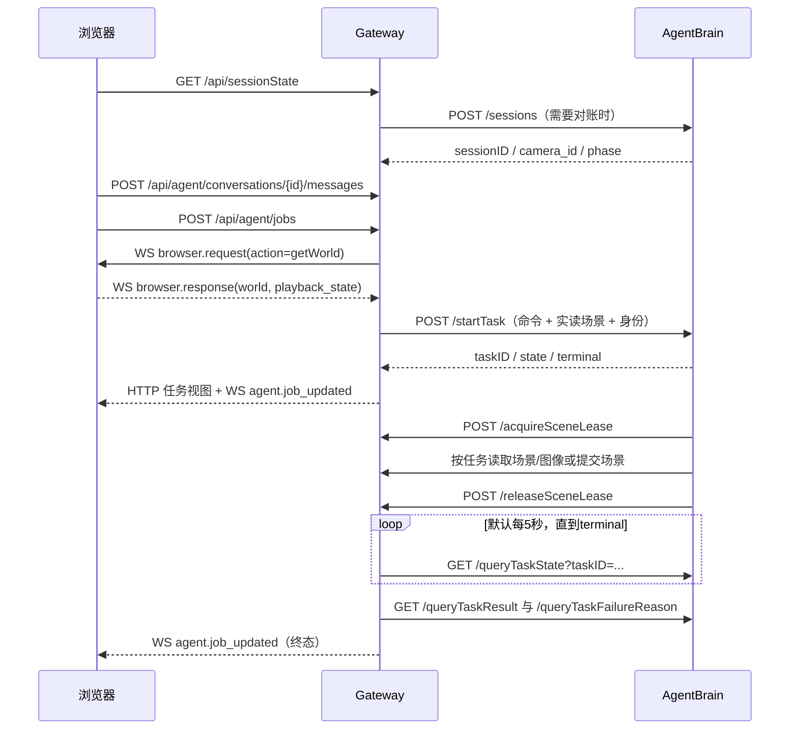

# 2026-10-25 联调总结：调用流程

本文记录当前实现，依据 `local_gateway.py`、`editor/src/main.ts`、`editor/src/scene_requests.ts`，以及 AgentBrain 的 `src/robot_agent_brain/web/{service,gateway,protocol}.py` 核对。请求示例中的 ID、摘要和场景为示意值，响应只展示关键字段，不是抓包原文。历史联调记录见 `docs/works/历史档案/前端和AgentBrain联调流程-原文.md`（原《前端和AgentBrain联调流程》），异常与竞态见《联调总结-1025-边界条件.md》。本次整理没有重新运行联调或 xhigh。

## 1. 服务职责与标识

| 参与方 | 本机地址 | 职责 |
| --- | --- | --- |
| 浏览器 | 打开 `http://127.0.0.1:8099` | 显示和编辑场景、加载资产、渲染相机图像、显示任务与会话历史 |
| Gateway | `127.0.0.1:8099` | 提供页面和浏览器 API；协调 session、历史行、场景快照、租约和提交回执；转发 Agent 请求并轮询任务 |
| AgentBrain | `127.0.0.1:8500` | 管理 Brain session、任务队列和推理；调用 Gateway 读取/提交场景；生成回复或技能计划 |
| OLS | `127.0.0.1:8000` | 场景、模型、机械臂元数据及资源文件；浏览器直接访问，Brain 也校验资产库 |
| QwenMock | `127.0.0.1:8080` | 提供本轮联调用模型响应；不代表真实机器人执行 |

浏览器的 Agent 请求只发给 Gateway，不直接访问 AgentBrain。Gateway 与 Brain 使用 HTTP JSON；Gateway 与浏览器通过 `/events` WebSocket 双向通信。任务进度是 **Gateway 轮询 Brain 后推送整个任务视图**，不是逐 token 聊天流。

AgentBrain 根据任务阶段向 QwenMock 发送 OpenAI 兼容请求：`POST http://127.0.0.1:8080/v1/chat/completions`。请求包含 `model`、`temperature:0`、`messages:[{role:"system",content:<阶段提示>},{role:"user",content:<阶段输入>}]`；启用结构化输出时还含 `response_format:{type:"json_schema",json_schema:{name:<阶段名>,strict:true,schema:<阶段schema>}}`。当前阶段名为 `task_understanding`、`skill_planning`、`vision_grounding`；规划阶段可另带 `max_completion_tokens`。若配置了 api key，Brain 会发送 Bearer Authorization；本机 mock 无需真实模型权重。

QwenMock 成功返回标准 Chat Completions 外层，关键结构为 `choices[0].message.content`，其值是 JSON 文本；还包含 `id`、`model`、`finish_reason:"stop"`、`usage`。Brain 将 content 解析并按本阶段契约验证，随后再形成自己的 task result。无法识别阶段时 mock 返回 HTTP 422 `unknown_stage`；模板错误返回 HTTP 500。模型服务的结果不是浏览器直接展示的聊天响应。

| 标识 | 含义与边界 |
| --- | --- |
| `browser_id` / `browserID` | 浏览器绑定标识，具体拼写随接口；同一时刻只有一个被绑定的浏览器承担现场请求 |
| `sessionID` | AgentBrain 会话标识；场景/相机切换或恢复时由 Gateway 与 Brain 协调 |
| `conversationId` / `conversation_id` | Gateway 历史行 ID。提交请求用前者，任务视图用后者；不能用 sessionID 替代，两个历史行可能关联同一 sessionID |
| `clientRequestID` | 一次用户任务提交的幂等键；同一次重试保留此值 |
| `taskID` / `task_id` / `id` | Brain 返回数值 taskID；Gateway 任务视图含数值 task_id 和字符串 id |
| `request_id` | 一次 Gateway→浏览器 WS 请求的关联 ID，与任务 ID 不同 |
| `transactionID` | 一次原子场景提交的 ID，用于查询回执和防重复提交 |
| 场景四元组 | `scene_id`、`scene_version`、`scene_sub_version`、`sceneDigest`；摘要由实际 JSON 的 JCS 规范化结果计算 SHA-256 |

## 2. 打开页面、刷新与健康状态

| 时机 | 调用方向 / 接口 | 发送内容 | 回复及后续 |
| --- | --- | --- | --- |
| 页面启动 | 浏览器→Gateway `GET /api/runtimeConfig` | 无请求体 | 配置对象，含 OLS 地址、超时、相机预览、features 等 |
| 页面启动和 WS 重连 | 浏览器→Gateway `GET /getWorld` | 无请求体 | **响应体直接是场景 JSON**；先恢复权威场景，再上报，避免页面初始空场景覆盖已保存的现场 |
| 恢复历史 | 浏览器→Gateway `GET /api/agent/conversations` | 无 | `{activeConversationId, conversations:[...]}`；存在活动行时继续 GET `/api/agent/conversations/{id}` |
| 建立连接 | 浏览器→Gateway `WS /events` | `{"type":"browser.hello","browser_id":"b1","role":"viewer"}` | Gateway 注册浏览器；hello 不返回一个 session 创建响应 |
| 已加载场景上报 | 浏览器→Gateway WS | `{"type":"browser.state_sync","payload":{"world":{...},"camera_object_ids":[5]}}` | Gateway 校验可采纳性，记录快照/四元组/相机候选，按需要自动绑定 session，再广播 `scene.applied` |
| 启动、重连、场景变化、发送前 | 浏览器→Gateway `GET /api/sessionState?browser_id=b1` | 查询浏览器 ID | 权威 session 视图，见下方示例；setup 下可能触发 Brain session 对账，不是纯粹读内存 |
| 启动及每 15 秒 | 浏览器→Gateway `GET /api/health` | 无 | Gateway 总体状态及 `agent_service`、`browser`、`assets` 子项；agent_owned 时同一计时器也刷新 sessionState |
| 聚合健康检查 | Gateway→Brain `GET /health`；Gateway→OLS `GET /list?type=model` | 无 | Brain 返回模型/浏览器/资产状态；Gateway 健康 HTTP 200 不等于所有依赖就绪 |

`/api/sessionState` 示例：

```json
{
  "sessionID": "s1", "browser_id": "b1", "camera_id": 5,
  "session_phase": "setup", "lease": null, "quarantine": null,
  "next_object_id": 16, "scene_id": 3, "scene_version": 3,
  "scene_sub_version": 0, "sceneDigest": "<64位小写hex>",
  "camera_candidates": [5]
}
```

Brain `/health` 的关键字段为 `service`、`protocol:"brain-web/2"`、`executed:false`、`qwen`、`browser`、`assets`、`browser_id`、`tasks:{active_task_id,queued}`、`capabilities`。Gateway `/api/health` 形如：

```json
{
  "status": "ok", "mode": "local", "uptimeSeconds": 60,
  "agent_service": {"status": "ready", "detail": null},
  "browser": {"connected": true, "browser_id": "b1"},
  "assets": {"reachable": true}
}
```

Gateway 另有 `GET /health` 原样转发 Brain 健康响应、`GET /api/agent/health` 最多缓存 5 秒的转发接口；当前页面状态栏实际使用 `/api/health`。健康请求不用于判定某个任务成功或失败。

## 3. 选择场景与创建会话

### 3.1 从资产面板加载

浏览器直接向 OLS 调用 `GET /list?type=scene|model|robot`、`GET /listCategory?type=...` 和 `GET /thumbnail?type=...&id=...`。列表返回 `items` 数组，分类返回 `category` 数组，缩略图返回图片字节。

选中场景后调用 `GET /scene?id=1`，返回完整场景文档。渲染时按 `MetadataRef` 调用 `/model?id=...` 或 `/robot?id=...` 获取元数据和文件入口，再用 `/file?type=model|robot&id=...&path=...` 读取几何、URDF、贴图等文件。本地 Load Scene 则在浏览器解析文件，不上传到 OLS。

加载完成后通过 `browser.state_sync` 上报整场景与相机对象 ID。Gateway 自动绑定路径向 Brain 发送：

```http
POST /sessions
Content-Type: application/json

{"browserID":"b1","camera_id":5}
```

Brain 返回：

```json
{"sessionID":"s1","browserID":"b1","camera_id":5,"session_phase":"setup","active":true}
```

相机候选来自浏览器，选择由 Gateway/Brain 协调；无相机也允许建立 session，具体任务仍需通过平台/相机能力检查。空白初始页面、场景上报、sessionState 对账、首次发送均可能涉及建立 session，不能把创建时间固定理解为“只在点击发送时”。

### 3.2 显式新建空对话

1. 浏览器先向 Gateway `POST /sessions`，发送 `browserID` 和 `expectedScene`（`scene_id=0, scene_version=0, scene_sub_version=0` 的空场景文档）。
2. Gateway 在会话转换锁内调用 Brain `POST /sessions`。`expectedScene` 只供 Gateway 识别过渡目标，**不会转发给 Brain**；若目标不同于当前场景，不继承旧场景相机，先发送 `camera_id:null`。
3. 成功后浏览器才切到空场景并发送 `browser.state_sync`，刷新 `/api/sessionState`。
4. 浏览器调用 Gateway `POST /api/agent/conversations` 建立独立历史行：

```json
{"sessionID":"s2","sceneID":0,"title":"场景会话 s2","scene":{"scene_schema_version":1,"scene_id":0,"scene_version":0,"scene_sub_version":0,"scene_name":"","objects":[]}}
```

响应 HTTP 201，结构如下：

```json
{
  "conversationId":"local-ab12cd34", "sessionID":"s2", "title":"场景会话 s2",
  "target":"platform", "presentationMode":"real-sync",
  "sceneBinding":{"sceneId":0,"simSessionId":"s2"},
  "sceneSnapshot":{"scene_schema_version":1,"scene_id":0,"scene_version":0,"scene_sub_version":0,"scene_name":"","objects":[]},
  "messages":[], "createdAt":"<ISO时间>", "updatedAt":"<ISO时间>"
}
```

随后重新 GET 历史列表。若场景上报已使 session 自动重绑，历史创建端会校准到当前 session/场景。新历史行建立前，旧历史行受保护，不能被新场景覆盖。

### 3.3 在已有任务的会话中选择另一个场景

资产面板提示新建会话，用户确认后走 `POST /sessions {browserID,allowActiveTask:true}`，再加载所选场景并上报。旧任务继续属于旧 session/历史行，其租约和快照转入旧会话上下文。新场景若与旧相机不匹配，会触发自动重绑。

注意入口区别：顶部 New conversation 当前使用 `createSession(false,true)`；资产切换确认路径使用 `createSession(true)`。存在租约时不能把两个入口概括为同样可以无条件切换；未确认提交或 quarantine 仍会拒绝转换。

## 4. 用户发送一轮任务



前端先等待会话转换、权威 session 刷新和历史行建立；固定 `sessionID + conversationId + scene`。写入用户消息期间若这些值改变，停止这次发送，避免命令落入另一会话。

### 4.1 保存用户消息

浏览器→Gateway `POST /api/agent/conversations/{conversationId}/messages`：

```json
{"role":"user","content":"把苹果放进篮子里","turnId":"<本轮clientRequestID>"}
```

回复完整历史行；按 `role + turnId` 去重。这是记录聊天消息，**不会启动 Brain 任务**。assistant 消息也可使用同一路径；任务终态时 Gateway 会先写入所属历史行，再广播，浏览器重复回传不会产生第二条。

### 4.2 创建任务

浏览器→Gateway `POST /api/agent/jobs`：

```json
{"command":"把苹果放进篮子里","scene":{"...":"浏览器完整场景"},"clientRequestID":"req-1","conversationId":"local-ab12cd34","sessionID":"s1"}
```

Gateway 校验会话归属、请求幂等键和同会话运行任务，必要时与 Brain 对账，然后通过 WS 实读浏览器现场：

```json
{"type":"browser.request","request_id":"r1","action":"getWorld","payload":{}}
```

```json
{"type":"browser.response","request_id":"r1","ok":true,"payload":{"world":{"...":"完整场景"},"scene_id":3,"scene_version":3,"scene_sub_version":0,"playback_state":"stopped"}}
```

Gateway→Brain `POST /startTask` 使用这次实读的场景及摘要，**不直接信任 jobs 请求体中的场景作为运行现场**：

```json
{
  "command":"把苹果放进篮子里", "scene":{"...":"同一次实读的完整场景"},
  "scene_id":3, "scene_version":3, "scene_sub_version":0,
  "sceneDigest":"<该scene的64位摘要>",
  "sessionID":"s1", "clientRequestID":"req-1", "browserID":"b1"
}
```

Brain 校验身份、摘要、平台支持情况和会话状态，入队后返回 HTTP 200：

```json
{"taskID":42,"state":"已进入队列","terminal":false,"code":0}
```

Gateway 受理后把所属 session 置为 `agent_owned`，响应任务视图，并广播 `agent.job_updated`。任务视图包含 `id:"42"`、`task_id:42`、`conversation_id`、`command`、`agent_state`、`terminal`、`state_detail`、`outcome`、`reply`、`plan`、`metrics`、`artifacts`、`commit_receipts`、`message`、`failure_reason`、`created_at/updated_at`。初始结果字段为 null 或空数组；不会回传整场景。

## 5. Brain 执行期间的回调

Brain Gateway adapter 在请求头中发送 `X-Brain-Session: <所属sessionID>`；获得租约后再带 `X-Brain-Lease: <leaseToken>`。这使旧后台任务能够访问自己的上下文，而不会误写新前台场景。

| 时机 | Brain→Gateway 接口 | 参数 / 请求体 | 响应 |
| --- | --- | --- | --- |
| 执行前、场景写入前；健康探针也使用 | `GET /brainCapabilities?browser_id=b1` | 浏览器 ID | `{protocol:"brain-web/2",browserID,capabilities:[...]}`；Brain 验证八项能力名 |
| 获取场景/校验现场 | `GET /getWorld?browser_id=b1&lease_snapshot=1` | `lease_snapshot=1` 可读取租约快照；收尾、采集及提交后核验会不带此参数 | 直接返回场景 JSON，加身份/来源响应头 |
| 任务执行前锁定 | `POST /acquireSceneLease` | `{taskID,browserID,scene_id,scene_version,scene_sub_version,sceneDigest}` | `{browserID,leaseToken}`；指纹不匹配则拒绝 |
| 需要视觉信息 | `GET /captureScene?id=5&type=rgbd&browser_id=b1` | 相机对象 ID，type 为 rgb/rgbd | PNG base64、尺寸、相机类型、身份；rgbd 另有 float32le 深度 base64 |
| 视觉对象框 | `GET /get2DAABB?id=8&camera_id=5&browser_id=b1` | 场景对象与相机 ID | `{id,camera_id,width,height,visible,box,...身份字段}`，box 为像素坐标边界 |
| 场景新增/删除/修改落地 | `POST /commitWorld` | transactionID、browserID、expected 四元组、候选 scene | committed/rejected 回执，详见下一节 |
| 提交响应丢失后取证 | `GET /queryWorldCommit?transactionID=tx1&browser_id=b1` | 原 transactionID | 已落盘回执；没有回执为 unknown，不能当成功 |
| 任务收尾 | `POST /releaseSceneLease` | `{browserID,leaseToken,keepLocked:false}` | `{browserID,state:"released"}` |
| 写入结果不确定 | 同上，`keepLocked:true` | 保留隔离 | `{browserID,state:"quarantined"}`，不是已解锁 |

`getWorld` 响应头包括 `X-World-Source`、`X-Browser-ID`、`X-Scene-ID`、`X-Scene-Version`、`X-Scene-Sub-Version`、`X-Scene-Digest`、`X-Next-Object-ID`、`X-Session-Phase`；live 读有 `X-Playback-State`，cache 读有 `X-World-Cache-Age`。当前实现也把受控的会话/租约快照标为 live，因此 **live 不总意味着此次 HTTP 请求刚向浏览器发过 WS**；新任务提交路径仍单独实读浏览器。

相机采集的 WS 请求仍使用统一的 `browser.request`，action 为 `captureScene` 或 `get2DAABB`，payload 除接口参数外携带 `browser_id` 和 `lease_token`。响应 payload 的身份字段是 `browserID`、四元组、`playback_state`。Gateway 校验身份、停止播放状态、尺寸和数据完整性；Brain 再校验图像及框。后台 session 的图像采集直接被拒绝，不能借用前台另一场景的像素。

### 5.1 原子场景提交

```json
{
  "transactionID":"tx1", "browserID":"b1",
  "expected":{"scene_id":3,"scene_version":3,"scene_sub_version":0,"sceneDigest":"<旧摘要>"},
  "scene":{"scene_schema_version":1,"scene_id":3,"scene_version":4,"scene_sub_version":0,"scene_name":"ur5e_table_sorting","objects":[]}
}
```

这里 objects 仅表示候选文档的位置，实际必须发送完整候选场景。Gateway 检查租约、expected、目标版本和事务幂等性；在线前台路径发送 WS `action:"updateWorld"`，payload 为 `{world:<候选>,expected_version:3,strict:true}`。浏览器严格应用，返回 `ok`、场景版本、对象数量、`rejected_objects` 等结果。任一拒绝项不得部分提交。

Gateway 将结果写入事务回执，并返回：

```json
{"transactionID":"tx1","browserID":"b1","status":"committed","scene_id":3,"scene_version":4,"scene_sub_version":0,"sceneDigest":"<新摘要>","rejected_objects":[]}
```

随后广播场景通知：

```json
{"type":"scene.applied","scene_id":3,"scene_version":4,"scene_sub_version":0,"scene_digest":"<新摘要>","session_phase":"agent_owned","action":"updateWorld","source_request_id":"<WS请求ID>"}
```

注意此事件用 `scene_digest`，其他接口四元组用 `sceneDigest`。事件不含完整场景；需要更新的浏览器通过 GET `/getWorld` 取回，再上报相机候选。已应用相同版本的浏览器主要补报候选和刷新 sessionState。

切走或关闭浏览器后，只有满足会话快照、租约、CAS 等条件的路径才可在 Gateway 完成提交；更新的是所属会话快照。不能将此理解为所有任务都能脱离浏览器成功。

### 5.2 保留但不是当前 Brain 主写入路径的接口

| Gateway 接口 | 请求 | 响应/用途 |
| --- | --- | --- |
| `GET /allocateObjectID?browserID=b1&count=2` | 申请对象 ID 范围 | `{object_ids:[...],next_object_id:...}`；持久水位单调递增。当前 Brain adapter 读取 `X-Next-Object-ID`，不要假定每次新增都调用这个端点 |
| `POST /updateWorld` | 请求体为完整世界，query 可带 expected_version | WS updateWorld，返回应用统计；普通写入版本规则不同于 strict commit |
| `POST /updateItem?id=...` | 完整对象文档，query 可带 expected_version | WS updateItem，替换一个对象 |
| `POST /addObject` | 对象文档，ID 可省略 | Gateway 可预分配 ID，转发浏览器应用 |
| `POST /removeObject?id=...&detach_children=...` | query，可带 expected_version | 默认级联删除；detach_children 控制直接子对象脱离 |
| `POST /updateTraj` | TRAJ 原始二进制或 multipart `trajs` | WS JSON 头后紧跟二进制帧，含 count/byte_lengths/byte_length；回复 `{ok,count,trajs:[统计...]}` |

当前 Brain 的严格写入使用 `/commitWorld`，不会因失败降级到 `/updateWorld`。`plan_ready` 只生成计划，不能据此声称 Brain 已调用 `/updateTraj` 或执行机器人动作。

## 6. 查询任务结果与展示

Gateway 默认每 5 秒向 Brain `GET /queryTaskState?taskID=42`，响应：

```json
{"taskID":42,"state":"进行中","terminal":false,"state_detail":null}
```

`state` 按 Brain 原文展示；唯一终态判断是布尔 `terminal:true`。终态后 Gateway 查询 `/queryTaskResult?taskID=42` 和 `/queryTaskFailureReason?taskID=42`。结果未准备好时 result 接口返回 HTTP 202；有结果为 HTTP 200，例如：

```json
{"taskID":42,"sessionID":"s1","outcome":"plan_ready","executed":false,"reply":"计划已生成，尚未执行。","artifacts":{"commands":"/tasks/42/artifacts/commands"},"commitReceipts":[]}
```

```json
{"taskID":43,"sessionID":"s2","outcome":"failed","executed":false,"reply":"grounding_missing: apple","error":{"code":"grounding_missing","message":"grounding_missing: apple"}}
```

failure 接口为 `{taskID,terminal,failureReason}`，正常完成通常为 null。结果还可含 plan、metrics、sceneDigest 等，按任务类型提供。

固定 outcome 为 `scene_updated / answered / clarification_required / plan_ready / failed`。Gateway 提取这些结果写入任务视图，并推送 `{"type":"agent.job_updated","payload":<任务视图>}`。前端只接受 `conversation_id` 属于当前历史行的更新；旧会话的结果仍保存到旧会话。

当前 Brain 的 artifacts 是名称→下载 URL 的对象；Gateway 的 `agent_artifact_names` 当前只接受数组，因此本轮这类对象不会自动进入任务视图的 artifacts 列表。这是现有形状差异，不能把“接口可下载”写成“前端一定展示下载入口”。Gateway 已提供 `GET /tasks/{taskID}/artifacts/{name}` 代理，只允许 `scene_config / scene_patch / commands / query_result`。

任务终态且没有 lease/quarantine 时，当前实现会回到 `setup` 并推送 `session.phase_changed`。已有用户消息的历史仍要求通过新会话确认流程切换场景；阶段恢复与聊天历史边界是两层规则。

## 7. 切换历史、断线恢复与不确定恢复

| 时机 | 调用 | 关键行为 |
| --- | --- | --- |
| 选中历史行 | 浏览器→Gateway `POST /api/agent/conversations/{id}/activate` | 若目标 session 已是 Gateway 当前 session，不再调用 Brain；否则通常向 Brain `POST /sessions {browserID,sessionID:<目标>,camera_id:null,allowActiveTask:true}` 恢复目标绑定，再返回历史详情；省略/置 null 的相机不会清除 Brain 为目标 session 保存的相机绑定 |
| 激活响应到达 | 浏览器应用 `sceneSnapshot`，WS state_sync，再 GET sessionState | 恢复的是该历史行自己的场景，不从刚离开的会话继承 |
| 刷新/重开页面 | 重复启动流程 | Gateway 进程仍在时恢复活动历史与场景；不能等同于跨 Gateway 重启的永久历史数据库 |
| WS 重连补任务 | `GET /api/agent/jobs?conversationId=...` | 返回 `{jobs:[...]}`；前端会检查当前选择，丢弃过期响应 |
| 历史任务状态补全 | `GET /api/agent/jobs` | 只把该历史消息引用的任务恢复到页面；单任务可 GET `/api/agent/jobs/{id}` |
| 删除历史 | `DELETE /api/agent/conversations/{id}` | 返回 `{ok:true}`；删除历史行不等于取消 Brain 任务；系统没有任务取消接口 |
| 不确定提交恢复 | 运维/调用方→Gateway `POST /resolveUncertain` | 请求 `{browserID,sessionID,transactionID,evidence:{receipt_status,live_digest,expected_digest,late_write_excluded}}`；返回 `{state,sessionID,...四元组,reason}` |

恢复结论可能包括保锁、隔离、恢复或要求新会话，必须看响应 state 和证据，不能只看 HTTP 200。该接口不是正常每轮任务必调，也没有浏览器自动清锁流程。AgentBrain 自身也暴露同名 `POST /resolveUncertain`，用于清理 Brain task store 的 uncertain 标记；它与 Gateway 的同名接口是两套状态，不是 Gateway 自动转发关系。Brain 侧请求使用 `browserID`、`sessionID`、可选 `transactionID`、`resolution` 和 `evidence`；Brain 会自行读取其平台现场并核对 `live_digest`、`expected_digest` 及迟到写入证据，结论为 `resolved` 或 `kept_locked`。Gateway 的 resolve 则读取本 Gateway receipt 和绑定浏览器现场，两个接口必须各自按响应判断。

## 8. 与旧文档的主要差异

1. 相机参数不再要求用户手选；自动相机绑定可能生成新的 Brain session，但应保留正确历史行和场景归属。
2. `agent_owned` 不是永久状态；任务完成且无锁/隔离后恢复 setup。历史已有用户消息时，场景切换仍需要新的会话边界。
3. 一次任务不一定改场景。计划成功仍 `executed:false`，四元组可以不变。
4. 正常任务的场景提交使用原子 `/commitWorld`；旧文档只写 updateWorld/updateItem 不足以描述当前路径。
5. 历史行、session、任务 ID 是三个不同概念；必须同时校验，不能只看当前全局 session。
6. Gateway 的会话历史、任务视图和 session contexts 主要保存在进程内；GatewayState/提交回执与 Brain task store 有自己的持久化。浏览器刷新与服务重启必须分别验收。
